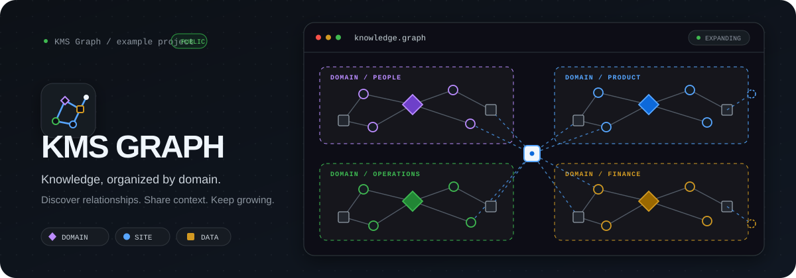

<p align="center"></p>

# KMS Graph

English · [한국어](README.ko.md)

KMS Graph is a read-focused internal knowledge portal for searching and exploring documents, work tools, and AI assets. It embeds approved material collected from CSV, Google Sheets, or Notion in a static site. Domain, department, and tags remain searchable metadata rather than graph nodes. Prompt text is accepted and displayed only for AI assets with the `프롬프트` subtype.

This public example contains synthetic sample data and no live organization's content or deployment settings. The repository is **source available under PolyForm Noncommercial 1.0.0**; commercial use requires separate permission.

## Quick start

Node.js 22.12+ (recommended) and Python 3.10+ are required. If using Node.js 20, use 20.19 or newer. Run from the repository root:

```bash
npm ci
npm --prefix frontend ci
python -m pip install -r requirements.txt
npm run sample:build
python -m http.server --directory out 8765
```

Open `http://localhost:8765`. Opening `index.html` directly over `file://` can prevent Workers and assets from loading under browser security rules.

For frontend development, run `npm --prefix frontend run dev`. The dev server uses 150 clearly marked sample items only when no embedded data exists. Open `http://localhost:5173/?demo=1000` for a 1,000-item graph stress check; this option has no effect in published builds.

## Using the portal

- Start in the compact library list to compare title, type, domain, owner, connected-item count, and update date. Switch to the graph to pan, zoom, and explore relationships.
- List view uses the same search, type, and business-domain filters. Opening a row keeps the list in place; its graph icon explicitly moves to the selected node.
- Press `/` to focus search and `Esc` to clear it. Selection is stored in the URL hash for browser back/forward navigation and shareable item links.
- `Open original` appears only when a work tool has a safe HTTP(S) address.
- Search ranks titles first and combines multiple terms across department, domain, relationship explanations, and shared project names. Details show provenance, URL-check status, relationship evidence, and review candidates since the previous publication.

## Inputs and builds

Local CSV examples are in `sample/`; `npm run sample:build` is the explicit demo build. For an operational build, copy `config.example.json` to the ignored `config.json`, set `repo_dir` to this repository's exact absolute path and `out_subdir` to `out`, then run `npm run build`. The production command requires `config.json`, builds the frontend, runs `build.py --config config.json --no-push`, and validates the resulting static files. It never falls back to sample data. External collection is not tested without account credentials. Never commit `config.json`, service-account keys, or tokens.

Cloudflare setup, validation, dry-run and deployment steps are documented in [docs/cloudflare-deployment.ko.md](docs/cloudflare-deployment.ko.md). The public repository's CI only tests sample builds. Its optional Notion deployment workflow requires a manual trigger and your own private configuration. `npm run deploy:dry-run` validates the configured output before invoking Wrangler. `npm run deploy` performs a fresh production build and validation before publishing; run it only after reviewing the local output and account target.

Schema version 2 JSON can add richer knowledge items and explicit relationships:

```bash
python build.py --csv-dir sample --knowledge sample/knowledge.json --out out --no-check-urls
```

Optional CSV/Sheets tabs `items`, `relations`, `shared_folders`, `shared_projects`, and `memberships` register approved independent items and shared folder → project → item organization. Equivalent optional Notion databases use `notion_db_<tab>` configuration keys. See [input examples](sample/explicit-inputs/README.md) and [data contract](docs/data-contract.md) for fields and approval rules. Missing approval never publishes; approved references to unpublished IDs fail the build. Shared organization is edited in the source, while personal organization remains browser-local. CSV builds and mocked Sheets/Notion responses are tested; real-account collection remains unverified.

The generated HTML contains all published data. Anyone who can read the static files can read that data; this application does not implement per-document authorization. Review the hosting and authentication layer before any external publication.

## Verification

```bash
npm --prefix frontend run typecheck
npm --prefix frontend test
npm test
npm run frontend:build
python test_build.py
python test_knowledge.py
```

The current scope is a searchable, read-only portal over collected material. The optional Cloudflare Worker verifies an Access JWT and an operator-configured email domain. Server persistence, collaborative editing, uploads, UI registration and per-document permissions, AI execution, and deployment to your account require separate setup or implementation.

The portal published through Cloudflare is read-only. Add, edit, or remove material in the connected Notion or Google Sheets source; the next static-site build publishes those changes.

## Main files

| Path | Role |
|---|---|
| `frontend/` | React + TypeScript UI and graph Worker |
| `build.py` | Input collection, validation, and static-site build |
| `knowledge.py` | Schema version 2 knowledge processing |
| `sample/` | Local test inputs |
| `out/` | Generated publish output (ignored by Git) |

## License

PolyForm Noncommercial 1.0.0. This is a source-available, noncommercial license, not an OSI-approved open-source license. Read [LICENSE](LICENSE) for the exact permission and restriction terms.
